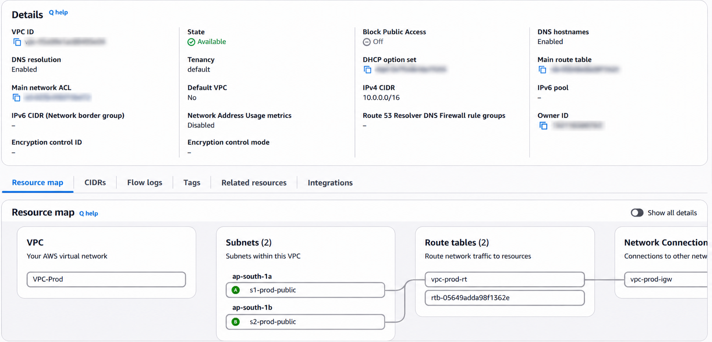
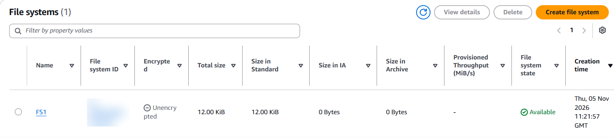
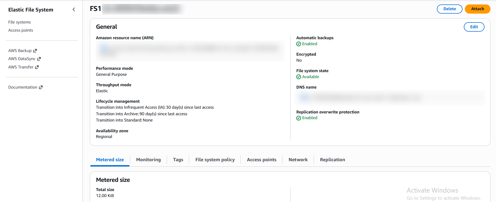
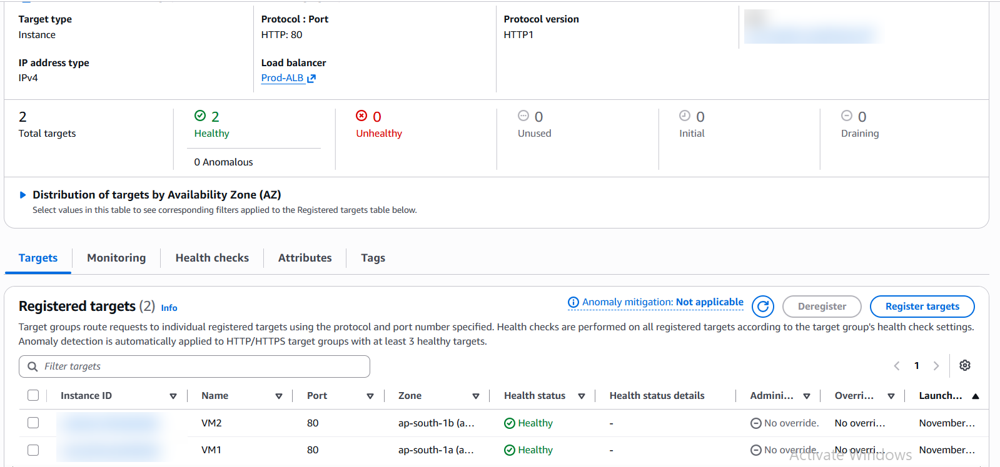

# AWS-SHARED-STORAGE-WEB-CLUSTER
Hosting a website using EFS, EC2 and Application Load Balancer.

## 1. Project Overview

This project demonstrates the implementation of a scalable web hosting architecture using Amazon Web Services (AWS).

Two Amazon EC2 instances are configured as Apache web servers. Both instances share website files through Amazon Elastic File System (EFS). An Application Load Balancer (ALB) distributes incoming HTTP traffic between the two web servers.

The architecture demonstrates shared network storage, load balancing, and high availability across multiple Availability Zones.

## 2. Project Objectives

- Deploy two EC2 instances as web servers.
- Configure Apache HTTP Server to host a website.
- Implement Amazon EFS for shared website storage.
- Mount the same EFS filesystem on both EC2 instances.
- Configure an Application Load Balancer to distribute incoming traffic.
- Verify target health and website accessibility.

## 3. AWS Services and Technologies Used

| Service / Technology | Purpose |
|---|---|
| Amazon EC2 | Hosts the two web server instances |
| Amazon EFS | Provides shared storage for website files |
| Application Load Balancer | Distributes incoming HTTP traffic |
| Amazon VPC | Provides an isolated virtual network |
| Subnets | Deploys resources across two Availability Zones |
| Security Groups | Controls inbound and outbound traffic |
| Amazon Linux 2023 | Operating system for EC2 instances |
| Apache HTTP Server | Hosts the website |
| Linux / Bash | Server configuration and administration |
| HTML | Website development |

## 4. Architecture

The project uses two EC2 instances deployed in separate Availability Zones within the Mumbai AWS Region (`ap-south-1`).

Both instances connect to the same Amazon EFS filesystem, which stores the website files.

The Application Load Balancer receives incoming HTTP requests and forwards them to the registered EC2 instances.

**Architecture flow:**

Internet → Application Load Balancer → EC2 Instance 1 / EC2 Instance 2 → Shared Amazon EFS

## 5. Implementation Steps

### Step 1: VPC and Networking Configuration
- Created a custom VPC.
- Configured two public subnets across separate Availability Zones.
- Configured Internet Gateway and route tables.
- Enabled DNS resolution and DNS hostnames.

### Step 2: EC2 Instance Configuration
- Launched two Amazon Linux 2023 EC2 instances.
- Deployed them in separate Availability Zones.
- Configured security groups for required network communication.

### Step 3: Amazon EFS Configuration
- Created an Amazon EFS filesystem.
- Configured mount targets in both Availability Zones.
- Configured security group access for NFS traffic on port 2049.
- Installed Amazon EFS utilities on both EC2 instances.
- Mounted the same EFS filesystem at `/var/www/html` on both instances.

### Step 4: Apache Web Server Configuration
- Installed Apache HTTP Server.
- Started and enabled the Apache service.
- Created an HTML webpage in the shared EFS directory.
- Verified that both EC2 instances could access the shared website files.

### Step 5: Application Load Balancer
- Created an internet-facing Application Load Balancer.
- Configured an HTTP listener on port 80.
- Created a target group and registered both EC2 instances.
- Verified that both registered targets achieved Healthy status.

### Step 6: Testing and Verification
- Verified the EFS mount using Linux filesystem commands.
- Checked Apache service status.
- Confirmed that both target group instances were healthy.
- Accessed the website through the Application Load Balancer DNS endpoint.

## 6. Project Screenshots

### VPC and Networking Configuration


### EC2 Instances


### EFS Filesystem


### EFS Mount Targets


### EFS Configuration Details


### Target Group Health


### Website Output


## 7. Repository Structure

```text
AWS-SHARED-STORAGE-WEB-CLUSTER/
│
├── README.md
│
├── scripts/
│   └── setup-webserver.sh
│
└── screenshots/
    ├── 1vpc-networking.png
    ├── 2.ec2-instances.png
    ├── 3.efs-filesystem.png
    ├── 4.efs-mount-targets.png
    ├── 5.efs-details.png
    ├── 6.target-group-health.png
    └── 7.website-output.png
```

## 8. Key Learnings

- Launching and configuring EC2 instances.
- Understanding VPC networking, subnets and Availability Zones.
- Configuring Amazon EFS and mounting shared network storage.
- Installing and managing Apache using Linux commands.
- Working with Linux shell scripts and administrative privileges.
- Configuring Application Load Balancers and target groups.
- Understanding health checks and shared storage architecture.

## 9. Future Improvements

- Implement HTTPS using AWS Certificate Manager.
- Configure Auto Scaling for EC2 instances.
- Automate infrastructure provisioning using Terraform.
- Improve website design and functionality.
- Implement monitoring using Amazon CloudWatch.

## 10. Conclusion

This project demonstrates a basic multi-instance web hosting architecture using Amazon EC2, Amazon EFS and Application Load Balancer.

It provides practical exposure to AWS infrastructure deployment, Linux server administration, shared storage configuration and load balancing.
